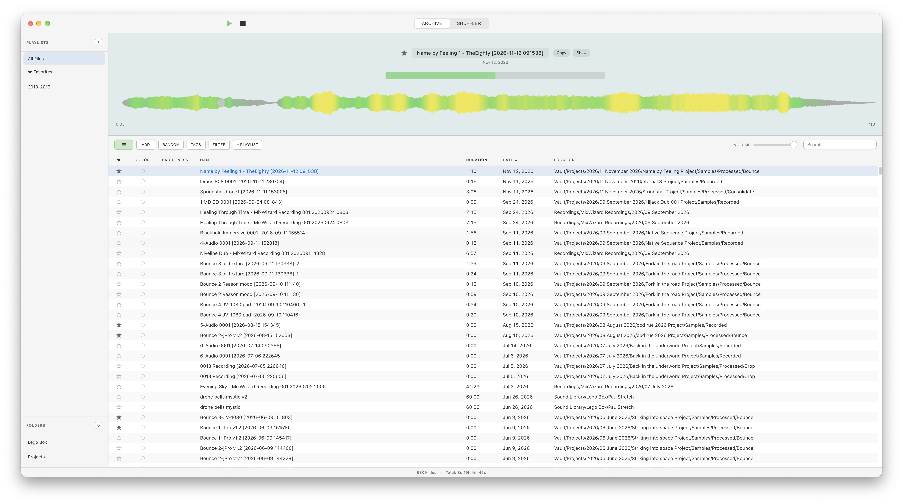
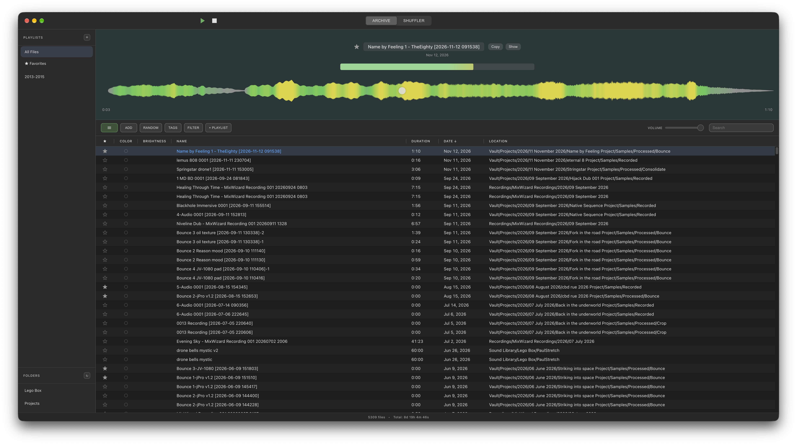
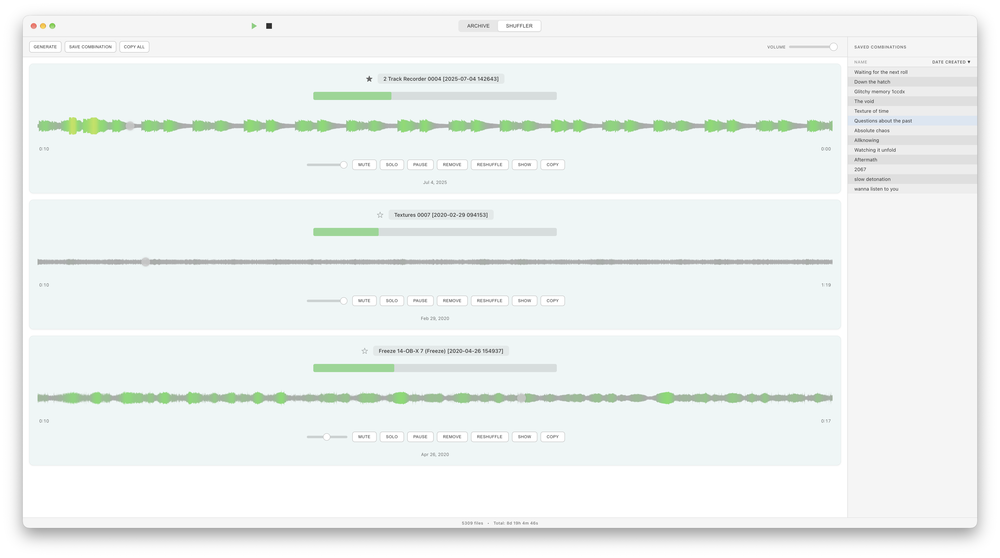
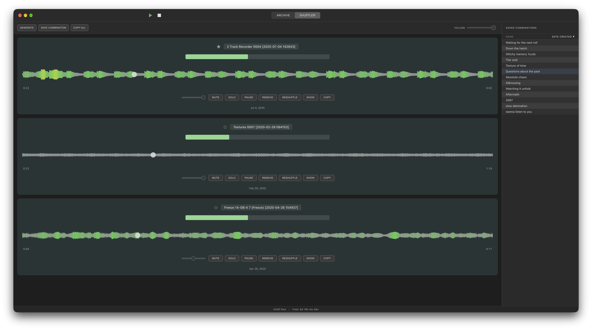

# Active Archive

This audio archive and shuffler application is inspired by Brian Eno and Peter Chilvers. I got the idea from seeing Brian Eno demonstrate their version in a video interview with Zane Lowe on the Apple Music channel and have been obsessed with it ever since. 

For almost a year I have been recurringly working on it in collaboration with Claude Code. I am not a coder and so I am grateful we live in a time where we can build out our own fantasies. There is obviously much to worry about and lament regarding music, arts and humanity in general but I set out to do something positive with it and now want to share with many who have also commented on the video wishing for such a program. 

It is more rudimentary and not as beautiful as Eno and Chilvers' original but I'm absolutely thrilled with how it turned out and actually using it every day with joy. For me, it acts as a time machine that puts me in touch with the pieces I've made over the years and the feelings that come along with them, that I would have otherwise forgotten about or wouldn't be able to access with this immediacy. It has reinvigorated my creative and artistic practice. It has pulled me away from the constant tension between a blank canvas, too many options and all the noise on the internet.

I am in no way attempting to profit off their idea and work, so this application will always remain free and open source for everybody to use it and do with it as they please. 

I hope you enjoy it and that it sparks your creativity. Peace and one love.

## Features

**Archive View**
- Browse and organize your audio library: WAV, AIFF, MP3, FLAC, M4A, AAC and OGG, including hi-res files (e.g. 96 kHz WAV)
- Random playback mode
- Search, sort by any column, and see the file count and total duration of what's shown
- Star favourites and gather sounds into playlists
- Tag each sound with a color and rate its brightness from 1–10
- Filter the archive by color, brightness and duration, and edit the color palette to taste
- Copy files to the clipboard to paste straight into Finder/Explorer or a DAW like Ableton, or reveal them in Finder
- Persistent waveform caching with IndexedDB
- Remember imported folders and rescan them — files moved between folders are matched by name + size so tags, colour, and brightness travel with them
- Locate missing files via a native dialog without losing their metadata
- Light and dark mode, following your system setting




**Shuffler View**
- Multi-track simultaneous playback of looping tracks
- Individual track controls (Mute, Solo, Pause) and a volume slider per track
- Reshuffle a single track to swap it for another random sound, or remove it
- Save, load, rename and duplicate track combinations
- Copy one track or all of them to the clipboard




## Installation

Download the latest version from the [Releases page](https://github.com/raphaelshklarek/Active-Archive/releases/latest):
- **macOS (Apple Silicon):** `Active.Archive-x.x.x-arm64.dmg`
- **Windows (x64):** `Active.Archive.Setup.x.x.x.exe`

The app is not signed with a paid Apple or Microsoft certificate, so your system will warn you the first time:
- **macOS:** if it says the app can't be opened, go to **System Settings → Privacy & Security** and click **Open Anyway**.
- **Windows:** in the SmartScreen dialog, click **More info → Run anyway**.

## Using the App

### Adding Files
1. Click the **ADD** button in Archive view
2. Select audio files or folders
3. Files are automatically analyzed and cached

Imported folders appear under **Folders** in the sidebar; use the rescan button to pick up new files.

### Playing Audio
- **Single file**: Click any file in the table
- **Random mode**: Click the **RANDOM** button to play files randomly (respecting the current playlist and filters)

### Tags, Filters and Playlists
- **TAGS** shows the colour and brightness filters and lets you tag all selected files at once; click a file's colour or brightness cell to set it individually
- **FILTER** narrows the archive to a duration range
- **+ PLAYLIST** creates a playlist; star a file to add it to **Favorites**

### Shuffler Mode
1. Click **GENERATE** to generate 3 random tracks
2. Use **MUTE**, **SOLO**, **PAUSE** to control individual tracks, and adjust each track's volume with its slider
3. Click **RESHUFFLE** on a track to replace it with another random sound
4. Click **SAVE COMBINATION** to save the current combination
5. Load combinations from the sidebar; right-click one to rename, duplicate or delete it

### Keyboard Shortcuts
| Key | Action |
| --- | --- |
| Space | Play / pause |
| Esc | Stop |
| Cmd/Ctrl + F | Search |
| Cmd/Ctrl + A | Select all files |
| Delete / Backspace | Delete selected files from the archive |

## Building from Source

Requires Node.js. Building the Mac app needs Xcode 26+ with its first-launch components installed (`sudo xcodebuild -runFirstLaunch`) for the Icon Composer icon.

```bash
npm install
npm run dev        # run in development
npm run build:mac  # build the macOS app into release/mac
npm run build:win  # build the Windows installer into release/win
```

## License

MIT

## Credits

Inspired by Brian Eno and Peter Chilvers' generative music applications and philosophy. Credit for the inspiration and my joy building and using this app goes to them.

[](https://www.youtube.com/watch?v=nR4JAonAR4g)
[Watch the video on YouTube that gave me the inspiration](https://www.youtube.com/watch?v=nR4JAonAR4g)
